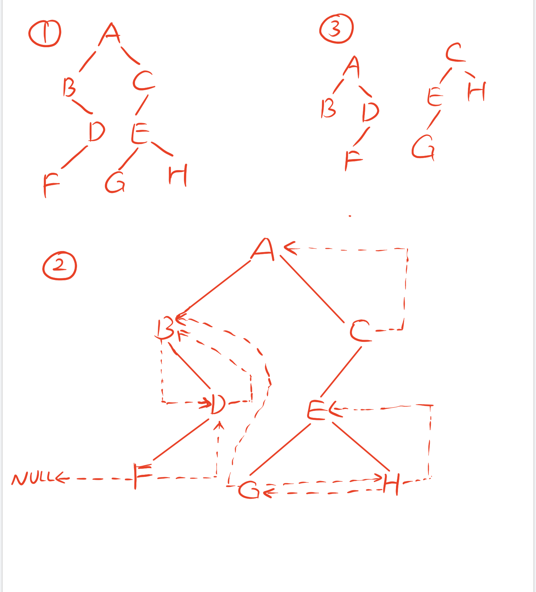
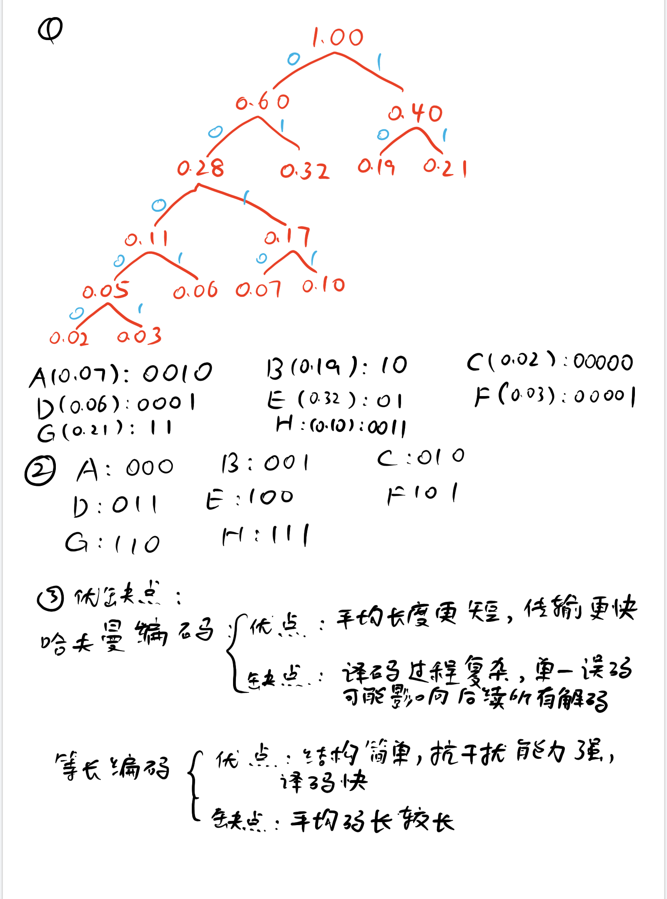

# 数据结构作业 3

> **姓名：** 常志强  
> **学号：** PB25030753

---

## 一、选择题

| 题号 | 答案 |
| :---: | :---: |
| 3 | D |
| 7 | C |
| 8 | B |
| 14 | C |

## 二、应用题
### (2)
<div align="center">
  
</div>

### (3)
<div align="center">
  
</div>

## 三、算法设计题
```cpp
#include <queue>

typedef struct BiTNode{
    int data;
    struct BiTNode  *lchild, *rchild;
}BiTNode, *BiTree;

bool SameTree(BiTree t1, BiTree t2){
    if(t1 == nullptr || t2 == nullptr){
        if(t1 == t2)
            return true;
        else
            return false;
    }
    if(t1->data != t2->data)
        return false;
    if(SameTree(t1->lchild, t2->lchild) == false)
        return false;
    if(SameTree(t1->rchild, t2->rchild) == false)
        return false;
    return true;
}

int MaxWidth(BiTree tree){ 
    if(tree == nullptr)
        return 0;
    std::queue<BiTree> q;
    int maxWidth = 0;
    q.push(tree);

    while(q.empty() == false){
        int width = q.size();
        if(width > maxWidth)
            maxWidth = width;
        for(int i = 0; i < width; i++){
            BiTree p = q.front();
            q.pop();
            if(p->lchild != nullptr)
                q.push(p->lchild);
            if(p->rchild != nullptr)
                q.push(p->rchild);
        }
    }
    
    return maxWidth;
}
```