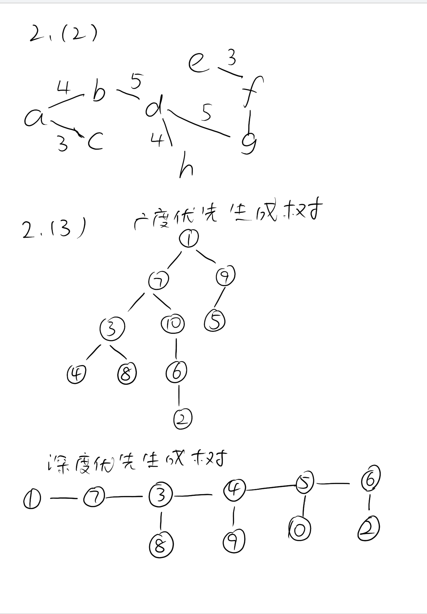

# 数据结构作业 3

> **姓名：** 常志强  
> **学号：** PB25030753

---

## 一、选择题
| 题号 | 答案 |
| :---: | :---: |
| 14 | D, D |

## 二、应用题
### q2 & q3
<div align="center">
  
</div>

### q4

| 终点             | \(i=1\) | \(i=2\)          | \(i=3\)           | \(i=4\)             | \(i=5\)             | \(i=6\)               |
| :------------ | :------------ | :-------------- | :--------------- | :----------------- | :----------------- | :------------------- |
| **b**          | 15<br>(a,b)    | 15<br>(a,b)      | 15<br>(a,b)       | 15<br>(a,b)         | **15<br>(a,b)**     | **15<br>(a,b)**       |
| **c**          | **2<br>(a,c)** | **2<br>(a,c)**   | **2<br>(a,c)**    | **2<br>(a,c)**      | **2<br>(a,c)**      | **2<br>(a,c)**        |
| **d**          | 12<br>(a,d)    | 12<br>(a,d) | 11<br>(a,c,f,d)   | **11<br>(a,c,f,d)** | **11<br>(a,c,f,d)** | **11<br>(a,c,f,d)**   |
| **e**          | \(\infty\)     | 10<br>(a,c,e)    | **10<br>(a,c,e)** | **10<br>(a,c,e)**   | **10<br>(a,c,e)**   | **10<br>(a,c,e)**     |
| **f**          | \(\infty\)     | **6<br>(a,c,f)** | **6<br>(a,c,f)**  | **6<br>(a,c,f)**    | **6<br>(a,c,f)**    | **6<br>(a,c,f)**      |
| **g**          | \(\infty\)     | \(\infty\)  | 16<br>(a,c,f,g)   |  16<br>(a,c,f,g) |  15<br>(a,d,g)       | **14<br>(a,c,f,d s)**     |
| **S<br>(终点集)** | {a, c}         | {a, c, f}        | {a, c, f, e}      | {a, c, f, e, d}     | {a, c, f, e, d, g}  | {a, c, f, e, d, g, b} |

## 三、算法设计题
```cpp
#define MAX_VERTEX_NUM 100
#include <stack>
#include <iostream>
#include <vector>

struct ArcNode {
    int adjvex;          
    ArcNode *nextarc;        
};

struct VNode {
    char data;               
    ArcNode *firstarc;       
};

struct ALGraph {
    VNode vertices[MAX_VERTEX_NUM]; 
    int vexnum, arcnum;             
};

bool visited[MAX_VERTEX_NUM];

void DFS_NonRecursive(ALGraph G, int v){
    for(int i = 0; i < G.vexnum; i++)
        visited[i] = false;

    std::stack<int> s;
    std::cout << G.vertices[v].data << ' ';
    visited[v] == true;
    s.push(v);

    while(s.empty() == false){
        int cur = s.top();
        ArcNode* p = G.vertices[cur].firstarc;
        while (p != nullptr && visited[p->adjvex]) {
            p = p->nextarc;
        }
        if (p != nullptr) {
            int w = p->adjvex;
            std::cout << G.vertices[w].data << " "; 
            visited[w] = true;
            s.push(w); 
        } 
        else {
            s.pop();
        }
    }
}

bool K_length(ALGraph &G, int u, int v, int k, int cur_len, std::vector<bool> &visited){
    if(u == v && cur_len == k)
        return true;
    if(cur_len > k)
        return false;
    
    visited[u] == true;
    ArcNode *p = G.vertices[u].firstarc;
    while(p !=nullptr){
        int cur = p->adjvex;
        if(visited[cur] == false){
            if(K_length(G, cur, v, k, cur_len + 1, visited))
                return true;
        }
        p = p->nextarc;
    }
    
    visited[u] = false;
    return false;
}
```

